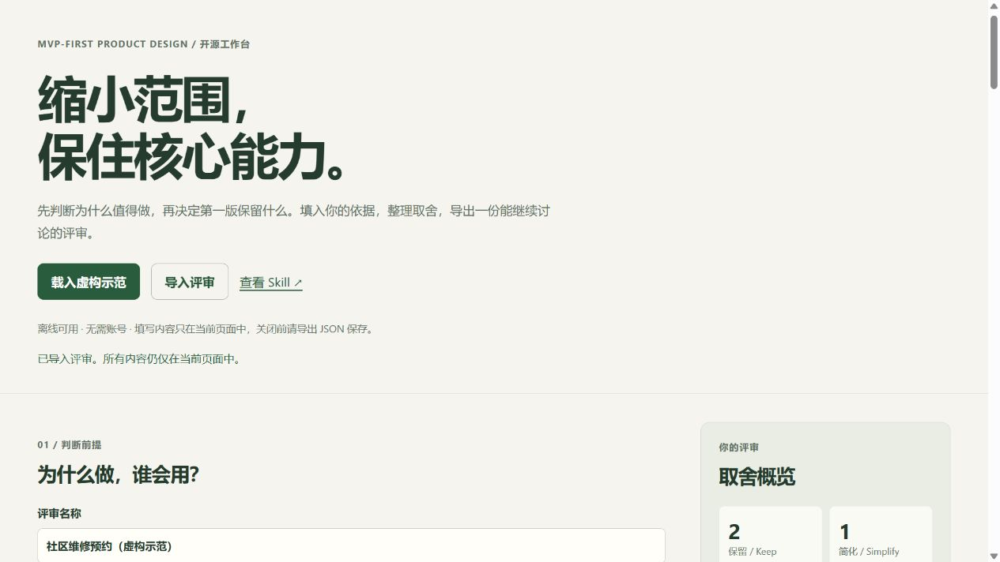

# MVP-First Product Design

让 AI 在拆功能、画页面、写代码之前，先判断产品为什么值得做，再收敛出能够验证核心价值的第一版。

**缩小范围，保住核心能力。**

现在包含可直接使用的离线评审工具、完整虚构案例、对比图和行为评估用例。整个仓库采用 [MIT 许可证](LICENSE)。

同库新增独立的 [AI 产品评测与复盘 Skill](skills/ai-product-evaluation/SKILL.md)。原 MVP Skill 保持不变，两个 Skill 可以分别使用或配合使用：

| Skill | 解决的问题 |
| --- | --- |
| `mvp-first-product-design` | 为什么值得做、第一版做什么、哪些能力不能削弱 |
| `ai-product-evaluation` | 怎样算做好、如何建案例集、Bad Case 为什么发生、修改有没有改善 |

评测 Skill 面向不同 AI 项目，不绑定某个业务或对话格式。每个项目自行定义质量维度、输出契约和案例库；工具支持纯文本和顶层结构化对象，不用问号数量或关键词代替语义判断。复杂图像、文件、UI 或 Agent 轨迹仍需证据适配。

### 配合使用

```text
先使用 $mvp-first-product-design 明确核心用户结果和首版范围。
再使用 $ai-product-evaluation 定义成功判据，建立固定输入、正常对照和失败案例。
结合实际输出分析问题：分开记录症状、候选原因、支持/反驳证据和最小验证。
修改后比较相同案例，再决定保留、继续验证、撤回或延期。
没有证据的原因标为假设，未运行或未评不能记为通过。
```

安装时，原 MVP Skill 使用仓库根目录；新增评测 Skill 单独使用 `skills/ai-product-evaluation/` 整个目录。两者是独立技能，不要只复制说明文档或假设安装一个就会自动加载另一个。

### 试用通用评测命令

在仓库根目录运行，需要 Node.js 22 或更新版本，无额外依赖、不调用 AI API：

```sh
node --test skills/ai-product-evaluation/scripts/eval.test.mjs
node skills/ai-product-evaluation/scripts/eval.mjs validate examples/ai-evaluation/receipt-extraction/suite.json
node skills/ai-product-evaluation/scripts/eval.mjs compare examples/ai-evaluation/receipt-extraction/suite.json examples/ai-evaluation/receipt-extraction/before.json examples/ai-evaluation/receipt-extraction/after.json
```

详见 [数据契约与命令](skills/ai-product-evaluation/references/tool-contract.md)、[评测协议](skills/ai-product-evaluation/references/protocol.md) 和 [非对话字段提取示例](examples/ai-evaluation/receipt-extraction/使用说明.md)。示例为手工合成，测试证明的是工具逻辑，不是模型效果或因果结论。原有 `tool/index.html` 是 MVP 范围评审工具；新增命令工具用于 AI 输出评测，两者用途不同。


## 先试一遍

1. 从 [Releases](https://github.com/deep-alain/mvp-first-product-design/releases) 下载完整 ZIP 并解压。
2. 双击 `tool/index.html`，点击“载入虚构示范”了解流程。
3. 填入你的需求与证据，整理功能取舍，导出 Markdown 报告或 JSON；JSON 可以重新导入。

工具离线可用，没有 AI API、账号和依赖。它整理输入并提示缺项及核心功能取舍冲突；产品结论仍需依据研究或结合 Skill 判断。关闭前请导出 JSON 保存。



| 配套材料 | 用途 |
| --- | --- |
| [离线评审工具](tool/README.md) | 填写评审、整理功能、导入与导出 |
| [完整虚构案例](examples/repair-appointments.md) | 从原始需求到首版范围的完整示范 |
| [评审模板](templates/review.md) | 复制到对话或文档中使用 |
| [行为评估用例](evals/README.md) | 检查核心能力、付费前提、证据真实性和明确要求 |

案例与评估输入都是教学材料，不是实际业务结果；行为评估用例尚未构成模型对照基准。

这是一个面向 AI Agent 的产品设计 Skill，适用于 MVP 规划、PRD、原型设计、已有界面简化，以及早期产品的范围审查。完整规则位于 [SKILL.md](SKILL.md)，界面元数据位于 [agents/openai.yaml](agents/openai.yaml)。

## 为什么做这个 Skill

使用 AI 做产品时，很容易从一个想法直接跳到功能清单：加仪表盘、加设置、加动效，再把每个可能出现的边界情况都做成页面。

这个 Skill 把判断顺序固定下来：先解释真实问题、预期结果和用户动机，再决定哪些功能值得进入第一版；保留下来的核心流程必须真正完成任务。

## 它会检查什么

| 判断 | 需要回答的问题 |
| --- | --- |
| 功能前提 | 需求来自什么问题？哪些是证据，哪些只是猜测？ |
| 用户动机 | 用户在什么情境下会主动使用？为什么不继续用现有办法？ |
| 付费价值 | 涉及商业化时，用户为哪部分新增价值付费？ |
| 因果与优先级 | 功能如何改变行为、进而影响结果？最弱的假设是什么？ |
| 第一版范围 | 哪些保留、简化、推迟或删除？ |
| 核心能力 | 缩小范围后，是否仍然交付完整、可靠且有用的结果？ |
| 可观察收益 | 用什么信号判断投入值得？是否考虑维护成本？ |
| 交互完整性 | 每个可见控件是否有用？取消、反馈、完成和错误状态是否连贯？ |
| 现有产品一致性 | 是否复用已有视觉、导航和控件模式？ |
| 项目信息保护 | 通用规则是否夹带能够还原来源项目的细节？ |

## 使用方式

将整个 `mvp-first-product-design` 文件夹交给支持本地 Skill 的 Agent，按该客户端的技能安装方式安装。文件夹必须保留 `SKILL.md` 和 `agents/openai.yaml` 的相对位置。

如果你在 Codex 中已经有可用的个人 skills 目录，把完整文件夹放到同一目录中，并在客户端确认技能已被识别。不同客户端和版本的发现目录可能不同，按当前客户端文档操作，避免只复制 README。

Codex 的 Skill 支持 `SKILL.md` 指令文件及 `agents/openai.yaml` 元数据。结构与编写说明见 [OpenAI 官方文档](https://developers.openai.com/plugins/build/skills)。

识别后，在对话里明确调用：

```text
使用 $mvp-first-product-design 审查下面的产品想法。
先判断为什么值得做、用户为什么主动使用，再给出第一版范围。
将功能分成保留、简化、推迟、删除四类，并说明理由。
保住核心流程的完整性，不要靠削弱主要能力来缩小范围。

我的产品想法：……
目标用户：……
已经掌握的证据：……
时间与资源约束：……
```

没有 Skill 加载能力的聊天工具，也可以手动提供 `SKILL.md` 全文作为方法参考；这不等于客户端原生安装。

## 更多调用示例

### 只做需求评审

```text
使用 $mvp-first-product-design 评审下面的 PRD，只分析，不修改文件。
指出最弱的产品假设、应先验证的问题、必要前置能力和最小可信实验。
给出 Keep / Simplify / Defer / Remove 清单。
```

### 简化现有界面

```text
使用 $mvp-first-product-design 简化这个页面。
沿用现有设计系统，优先保留主任务、必要反馈和完整交互。
解释每项删减对任务完成的影响，并检查相关响应式及禁用状态。
```

### 审查商业化功能

```text
使用 $mvp-first-product-design 评审这项付费功能。
区分平台收入目标与用户购买动机，检查相对现有权益的新增价值。
不要把用户兴趣当成购买证据；不确定时给出最小验证方案。
```

## 预期产出

1. 功能前提判断，以及继续设计、先验证、先补前置能力或推迟的建议。
2. 核心用户、主任务、最短完整流程和待验证假设。
3. 保留 / 简化 / 推迟 / 删除清单及其依据。
4. 保留项的预期收益、可观察信号与总维护成本。
5. 必须守住的核心能力、必要质量和完整交互。
6. 暂不支持的范围、临时处理方式及重新评估的证据条件。

输出规模应匹配问题规模，小改动不需要生成长篇报告，也不应反复追问已有信息。

## 使用边界

- MVP 需要真实交付核心价值，不能用假按钮、断开的流程或明显降低质量来替代。
- 不应以精简为由删掉明确要求、必要权限保护或重要数据完整性约束。
- 成熟产品明确要求品牌表达、视觉打磨或发布质量时，应尊重这些要求。
- Skill 提供决策方法，不会凭空创造用户证据，也不保证商业成功。
- 当前发布材料保留原始规则，未附跨模型效果基准或量化效果承诺。

## 文件结构

```text
mvp-first-product-design/
├── SKILL.md
├── agents/
│   └── openai.yaml
├── README.md
├── CHANGELOG.md
├── LICENSE
├── tool/          离线评审工具与逻辑测试
├── examples/      完整教学案例
├── templates/     可填写评审模板
├── evals/         行为测试输入与评审标准
├── skills/ai-product-evaluation/  独立通用 AI 评测 Skill、协议与离线命令工具
├── examples/ai-evaluation/       合成的跨项目评测示例
└── assets/        方案收敛对比图
```

## English overview

An agent skill for requirement-led MVP planning and product design. It evaluates the feature premise, user motivation, willingness to pay when relevant, and observable benefits before decomposing a concept into features and screens.

The method classifies scope into Keep, Simplify, Defer, and Remove while preserving the strength and end-to-end integrity of the retained core. It also covers interaction integrity, existing design-system reuse, ownership cost, and protection of source-project information.

The complete English instructions are in [SKILL.md](SKILL.md).

The repository also includes a dependency-free offline review tool (`tool/index.html`), a synthetic worked example, a review template, and behavioral evaluation cases. The tool organizes user input; it does not call an AI model or verify business assumptions. Licensed under MIT.

## 开发与贡献

测试工具逻辑：`node --test tool/tests/model.test.js`。运行测试需要 Node.js，使用工具本身不需要。

欢迎通过 Issue 反馈问题或通过 Pull Request 提议修改。贡献者不能直接改写此仓库；是否合并由仓库维护者决定。不要在反馈中提交真实项目的敏感材料，示例应经过泛化。
