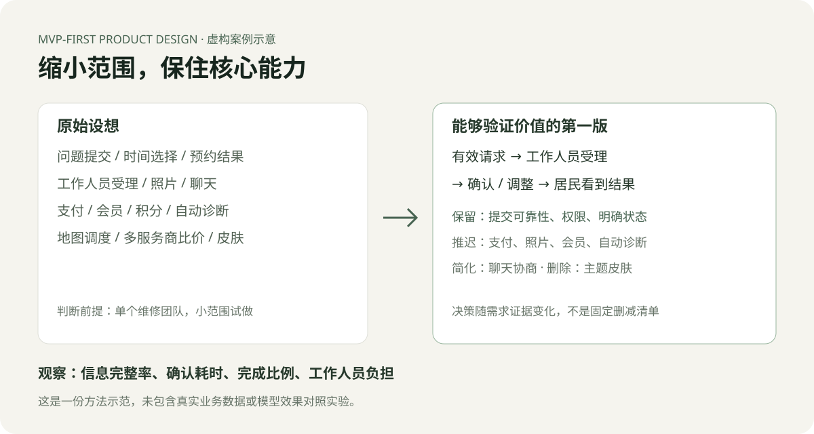

# 完整示范：社区维修预约

这是一个完全虚构的教学案例。场景、输入证据与决策均为编写的示范，没有真实用户访谈、业务数据或模型对照实验。用它理解方法，不能用它证明 Skill 的实际提升幅度。

## 1. 原始需求

为社区维修服务设计预约工具。目标用户是已经决定找维修人员、希望提交问题并得到预约确认的居民。团队只有两名开发人员，计划用四周试做。

设想中的首版包括：提交问题、时间段选择、上传照片、预约状态、工作人员确认、在线支付、积分商城、会员、聊天、地图调度、多个服务商比价、主题皮肤和智能故障诊断。

示范设定中的已有观察：居民目前发消息预约，工作人员需要反复追问地址、可接受时间和问题描述；提交后，居民经常不知道预约是否已被确认。示范中没有付费访谈，也没有证据表明积分、皮肤或自动诊断能提高完成率。

## 2. 先判断为什么做

**问题：** 预约信息不完整，确认结果不清楚。**主要结果：** 居民能提交有效请求并得到明确的确认、改期或无法受理结果。

**主动使用动机：** 需要维修时，居民想知道什么时候有人来，希望一次提交完成并收到确认。当前聊天方式的问题是补充信息和等待状态不明。

**支付动机：** 维修本身可能收费，但没有证据证明居民愿意为预约工具付会员费。首版先验证预约价值，不假定会员能带来新增价值。

**因果假设：** 一次收集必要信息 → 减少工作人员追问 → 更快确认 → 更多有效请求完成预约。最弱的假设是工作人员是否愿意持续处理统一的请求队列；只做居民端页面不能验证它。

**决定：** 先限定一个维修团队、一个服务区域，用一个居民请求页面和一个工作人员列表试做。预约“确认”由工作人员给出，不能把居民选择时间直接当作已确认。

## 3. 守住核心结果

最短流程：填写维修问题与联系方式 → 选择希望的时间 → 提交并得到回执 → 工作人员受理并确认或提出调整 → 居民看到处理结果。

必要质量：请求不能丢失；时间语义清楚；居民只能查看自己的请求；工作人员确认有记录；提交失败可重试且不会重复创建。核心是完成一次真实预约，不能止于“提交成功”的演示。

## 4. 第一版取舍

| 项目 | 决定 | 理由 / 收益 / 成本 |
| --- | --- | --- |
| 必要信息提交 | Keep | 完成预约所需；观察首次提交完整率；维护字段验证和提交可靠性 |
| 希望的时间段 | Simplify | 使用少量可选时段，注明待确认；减少反复询问；工作人员仍负责安排 |
| 预约状态及处理结果 | Keep | 居民要知道是否受理；观察状态查询与完成率；维护请求关联和状态记录 |
| 工作人员列表与确认 | Keep | 居民提交必须有承接；观察受理时间；维护权限和处理动作 |
| 照片上传 | Defer | 先收文字，必要时人工索取；记录因缺照片无法判断的请求 |
| 在线支付 | Defer | 试做阶段已有线下结算办法；记录预约中断是否与付款方式有关 |
| 聊天 | Simplify | 首版显示处理结果与联系方法，复杂协商人工完成；减少持续维护成本 |
| 地图调度与比价 | Defer | 当前只有一个团队；多服务商场景未进入试做范围 |
| 会员与积分 | Defer | 没有新增价值或购买证据，不优先验证收入机制 |
| 主题皮肤 | Remove | 与完成维修预约无可观察联系 |
| 自动故障诊断 | Defer | 预约并不要求自动诊断；人工受理能先验证需求 |

这些决定只适用于本案例的前提。例如已有成熟在线支付系统且结算是完整预约的一部分时，支付可能是 Keep，不能把本表当作通用删功能清单。

## 5. 必要状态与交互

- 提交中：防止重复提交，保留已填写内容。
- 提交失败：解释未创建请求，支持重试。
- 待处理：注明这是请求，尚未确认上门时间。
- 已确认：显示确认时间和工作人员给出的结果。
- 需要调整 / 无法受理：显示原因与联系方法，居民不会停在无法理解的状态。
- 取消：如取消将使维修安排失效，说明后果后让用户确认。

照片控件、支付入口和积分入口不放到界面中等待未来实现。

## 6. 怎么验证

先记录现有聊天流程中的追问次数、有效请求数量及受理时间，再用同一个小团队和类似请求量试做两周。这里的两周是教学用实验安排，不是从真实数据得出的结论。

观察首次提交信息完整率、提交到明确结果的时间、最终确认的比例和工作人员处理负担。浏览量、点击数不能单独证明预约改善。样本量不足时记录个案和流程问题，不宣称统计显著。

如果工作人员仍需频繁追问，修复字段或流程；如果没人处理列表，先解决承接方式，不增加居民端功能。是否扩展用实际对照结果和团队可承受的维护成本决定，不预先编造增长目标。

## 7. 推迟事项何时重开

| 推迟内容 | 当前处理 | 重开条件 |
| --- | --- | --- |
| 照片 | 人工索取 | 缺照片反复阻塞核心预约，且成本超过团队事先约定的可接受范围 |
| 自动改期 | 工作人员提出调整 | 手工协调成为受理时间的主要瓶颈 |
| 支付 | 沿用线下结算 | 有观察表明现有结算阻塞预约，且新方案收益超过集成和维护成本 |
| 多团队 | 限制试做入口 | 单团队流程成立，并取得其他团队参与的证据 |

## 8. 最终范围

交付居民请求页、自己的预约结果页、工作人员处理列表和必要的数据及权限保护。先验证“有效提交能被及时承接并得到确认”，再决定是否扩展。

